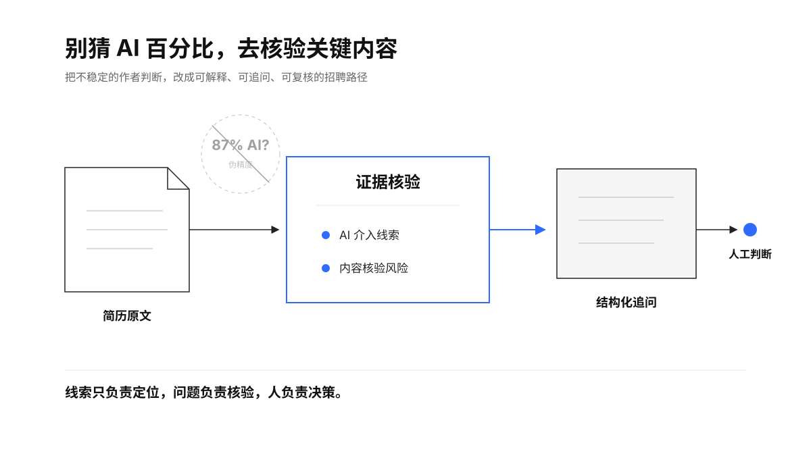
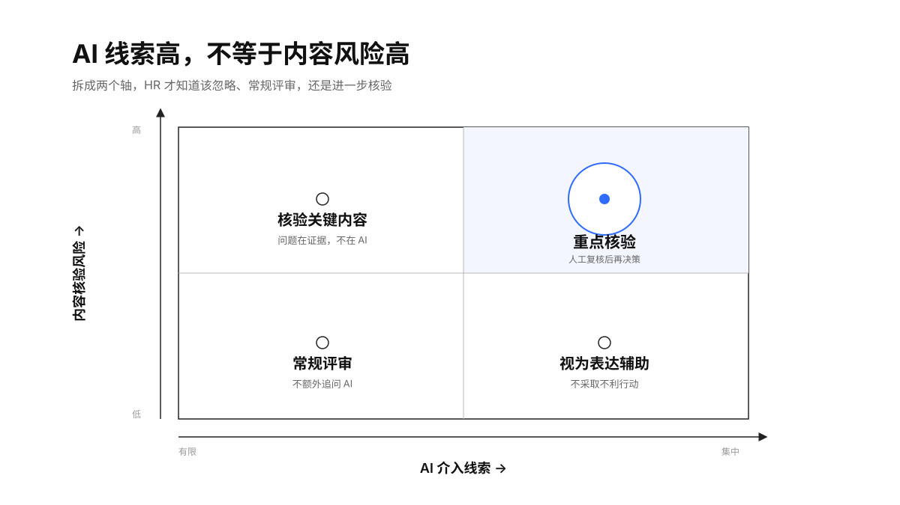
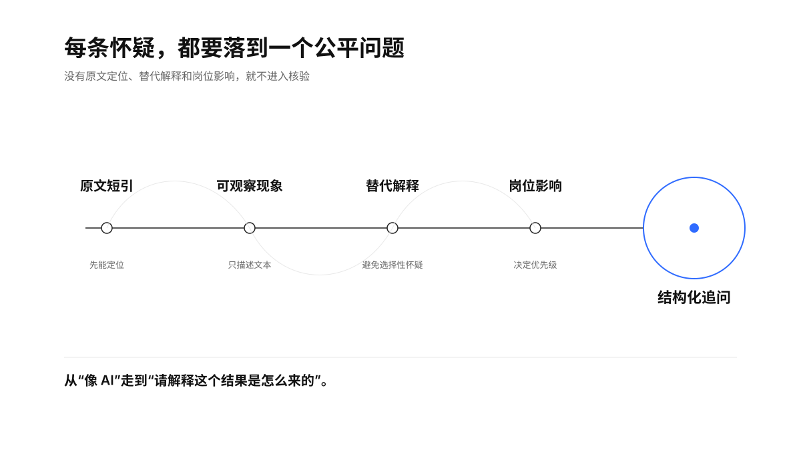
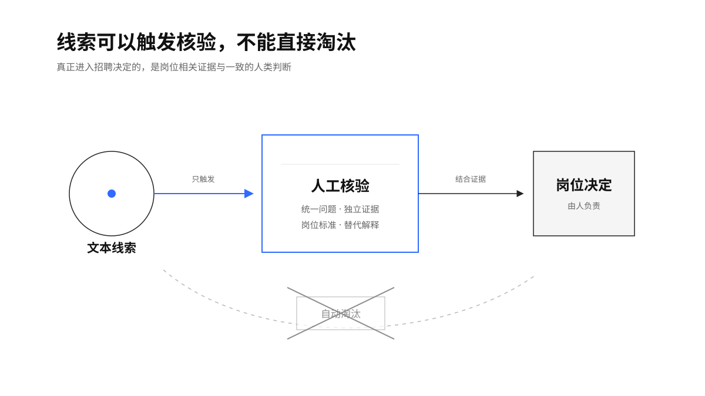

> “The percentage ... should not be used as the sole basis for action.” — [Turnitin, AI writing detection guidance](https://www.turnitin.com/products/features/ai-writing-detection)

<h1 align="center">简历AI含量识别</h1>

<p align="center">
  
  
  
  
  
</p>

<p align="center">不猜一个“87% AI”，而是告诉 HR：哪里值得怀疑、为什么不能定罪、下一步问什么。</p>

<p align="center">
  
</p>

## 它解决什么问题

候选人用 AI 润色简历并不等于经历虚假；一份完全由人写的模板化简历，也可能被通用检测器误报。真正对招聘有用的不是“作者鉴定”，而是区分两件事：文本是否存在集中化的 AI 辅助写作线索，关键经历是否缺少能支撑录用判断的证据。

这个 Skill 把两件事拆成两个轴：

- **AI 介入线索**：证据不足 / 有限 / 明显 / 集中；
- **内容核验风险**：低 / 中 / 高。

两个轴不互相替代。AI 线索明显但内容可核验，不应成为扣分理由；AI 线索有限但核心经历矛盾，仍然需要重点核验。

<p align="center">
  
</p>

## 工作方式

1. 提取简历正文，默认移除姓名、联系方式和与岗位无关的个人信息；
2. 定位模板收敛、语言均匀化、岗位描述镜像、语体突变和明确工具痕迹；
3. 为每条观察补上合理的替代解释，不把流畅、标准句式或非母语表达当成 AI 证据；
4. 独立评估关键经历的责任边界、指标口径、一致性和可核验性；
5. 把高影响、低确定性的陈述改写为中性的结构化追问；
6. 由 HR 结合岗位标准和核验结果做人工判断。

<p align="center">
  
</p>

## 快速使用

### Codex

[Codex 官方 Skills 手册](https://learn.chatgpt.com/docs/build-skills.md)说明，Standalone Skill 可放在仓库或用户级的 `.agents/skills` 目录；也可以让 `$skill-installer` 从 GitHub 仓库安装。安装后可显式调用：

```text
Use $resume-ai-content-review to review this resume for AI-assistance signals,
separate content-verification risk, and produce fair interview questions.
```

仓库级手动安装示例：

```bash
git clone https://github.com/TongyiDai/resume-ai-content-review.git \
  .agents/skills/resume-ai-content-review
```

### 豆包工作

[豆包工作帮助中心](https://www.doubao.com/work/docs/zh-cn/articles/081010973544-skills)说明，技能页支持上传本地技能文件或文件夹；技能至少需要一个带 YAML 名称和描述的 `skill.md`。下载本仓库或 Release 中的 zip，在“技能 → 上传技能”中导入即可。文件系统通常区分大小写时保留标准文件名 `SKILL.md`；若宿主只识别小写，可在上传副本中改名为 `skill.md`。

### 其他 Agent

核心遵循[开放 Agent Skills 规范](https://agentskills.io/specification)：`SKILL.md` + `references/` + 可选 `scripts/`。任何能读取 Markdown 技能说明的 Agent 都可以执行主流程；Python 脚本只是零依赖的本地特征提取增强，不能执行脚本时仍可按指标手册人工审查。

## 可选的本地特征提取

对已提取的 UTF-8 文本或 Markdown 运行：

```bash
python3 scripts/analyze_resume.py tests/fixtures/synthetic_resume.md --format markdown
python3 scripts/analyze_resume.py tests/fixtures/synthetic_resume.md --format json
```

脚本定位量化覆盖、重复开头、句长均匀度、模板短语和弱证据表达。它不会输出 AI 概率，也不会给出录用建议。PDF、DOCX 和图片请先在本地提取文本；不要为了检测把真实简历默认上传到第三方服务。

## 输出长什么样

```markdown
## 一句话结论

文本存在明显的统一重写痕迹，但这不能证明经历虚假；
有 2 条高影响成果需要通过过程和指标口径核验。

| 维度 | 结论 | 依据 |
|---|---|---|
| AI 介入线索 | 明显 | 两类线索跨 4 条经历重复 |
| 内容核验风险 | 中 | 2 条核心成果缺少基线与责任边界 |

优先追问：
1. 这个指标的统计区间、分母和数据源是什么？
2. 你本人负责哪部分，团队还有哪些角色？
3. 当时放弃过什么方案，为什么？
```

完整格式见 [`references/report-template.md`](references/report-template.md)，审查指标见 [`references/rubric.md`](references/rubric.md)。

## 边界

这个项目识别的是**可观察线索**，不是作者身份；生成的是**核验动作**，不是诚信判决。它明确禁止：

- 输出“AI 含量 87%”一类无法校准的伪精度；
- 仅凭检测结果自动拒绝、降序或标记欺诈；
- 把非母语表达、翻译、职业顾问或无障碍工具使用当作不诚实；
- 分析受保护特征或与岗位无关的个人信息；
- 未经授权把真实候选人材料上传到第三方服务。

<p align="center">
  
</p>

## 为什么不直接接一个 AI 检测器

[RAID](https://github.com/liamdugan/raid) 显示检测器会受未知模型、领域、解码策略和对抗改写影响；[相关研究](https://arxiv.org/abs/2304.02819) 还发现非母语英语写作存在显著误报风险。DetectGPT、Fast-DetectGPT、Binoculars 和 Ghostbuster 都是有价值的研究路线，但没有把任意短简历变成可靠的作者身份证明。

因此，本项目复用的是研究的评测思路与失败边界，不复刻一个通用分类器。完整先例地图与出处见 [`references/evidence-base.md`](references/evidence-base.md)。

## 验证

```bash
python3 -m unittest discover -s tests -v
python3 scripts/analyze_resume.py tests/fixtures/synthetic_resume.md --format json
```

CI 覆盖 Python 3.8、3.11 和 3.13。测试材料全部为合成数据，不包含真实候选人、公司或联系方式。

## 目录

```text
.
├── SKILL.md                         # Agent 工作流与安全边界
├── agents/openai.yaml               # Codex / ChatGPT UI 元数据
├── scripts/analyze_resume.py        # 零依赖、本地、非判定式特征提取
├── references/
│   ├── rubric.md                    # 指标、反例和双轴决策规则
│   ├── report-template.md           # 标准报告模板
│   └── evidence-base.md             # 研究依据与先例地图
├── tests/                            # 合成夹具、单元测试和触发样例
└── assets/boards/                    # Geometry Blue 解释图
```

## License

[Apache License 2.0](LICENSE)
