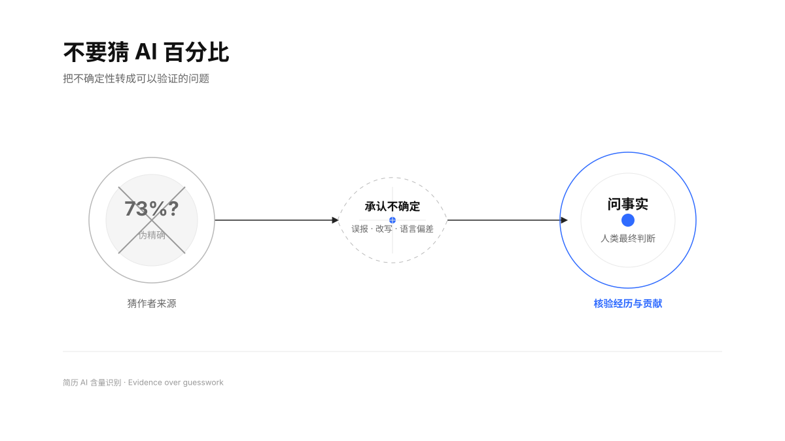
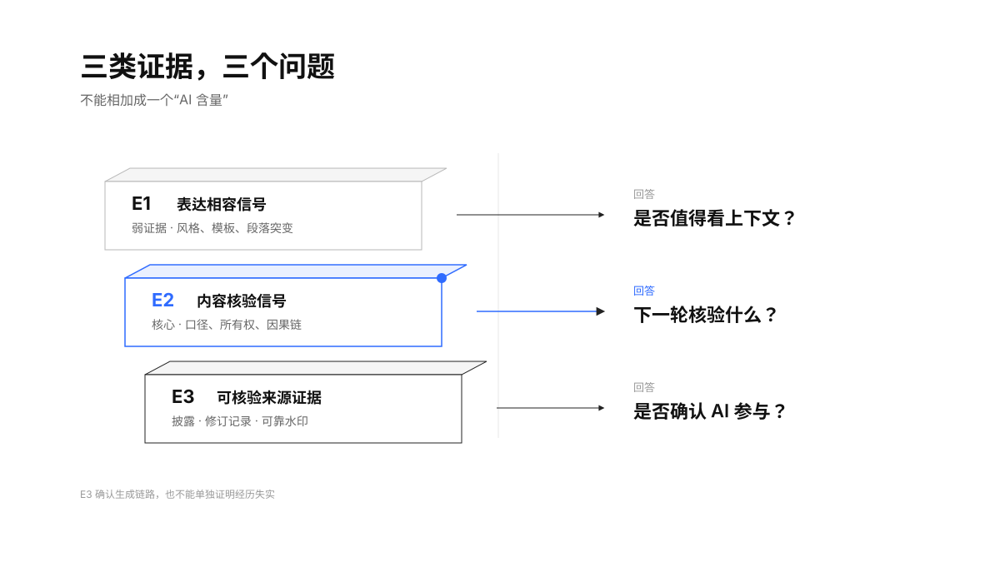
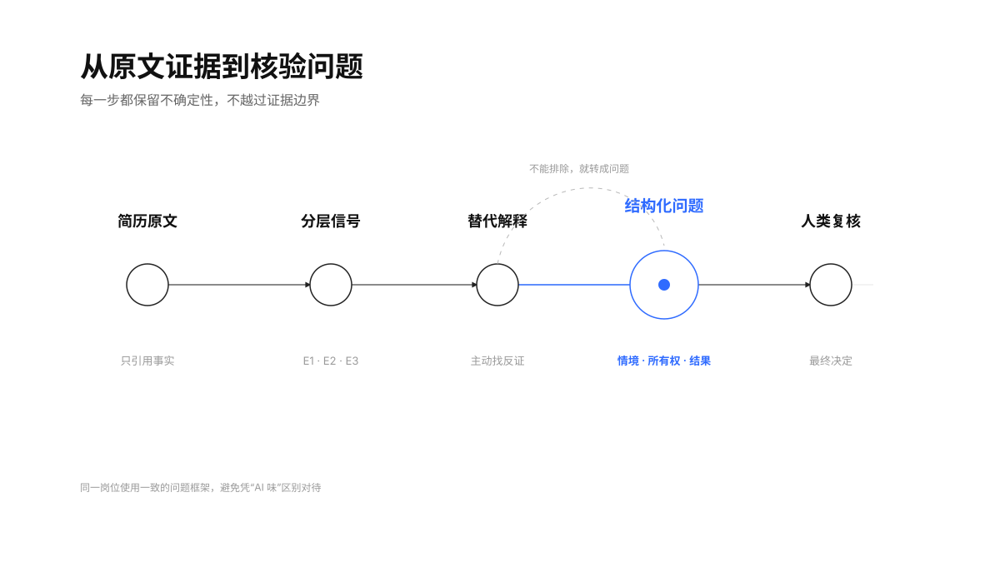
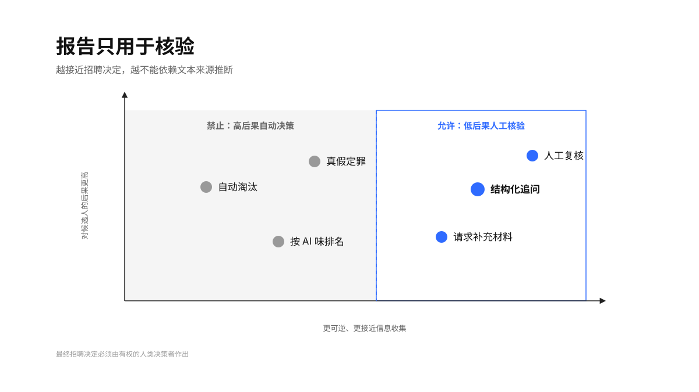

> “It is generally not appropriate to automatically reject textual submissions in high-stakes circumstances that are classified as being produced by a generative AI system.” — [ACM U.S. Technology Policy Committee](https://www.acm.org/public-policy/ustpc/ustpc-gai-detection)

<h1 align="center">简历 AI 含量识别</h1>

<p align="center">
  
  
  
  
  
</p>

<p align="center">不猜作者，不造分数；把“AI 味”转成有证据、可复核的招聘问题。</p>

## 它解决什么

通用 AI 文本检测器擅长给出一个看似明确的分数，但简历是短文本、模板文本、专业编辑文本，也是翻译和语法工具的高频场景。研究反复发现：检测器会受改写、领域、长度和语言背景影响；一个高分既不能证明“由 AI 写成”，更不能证明“经历造假”。

这个 Skill 把任务从“判作者”改成三件更可靠的事：找到值得注意的文本信号、区分合理的替代解释、生成能验证经历与个人贡献的结构化问题。

<p align="center">
  
</p>

## 三层证据框架

分析结果不输出 AI 百分比，而是分成互不替代的三层证据：

- **E1 表达相容信号**：只能说明文字与模板、人工编辑或 AI 辅助相容，是弱证据；
- **E2 内容核验信号**：时间线、指标口径、所有权、因果链等真正值得在面试中核验的内容；
- **E3 来源证据**：主动披露、修订记录或适用于该生成链路的可靠水印，只确认某种 AI 参与。

E1、E2、E3 回答的是三个不同问题，不能相加成一个“AI 含量”。即使存在 E3，也不能单独推导经历不真实或能力不足。

<p align="center">
  
</p>

## 工作方式

1. 读取简历、求职信或申请问答，默认忽略姓名、联系方式、照片和受保护信息。
2. 按真实章节建立同一份材料内部的基线。
3. 逐条记录 E1 / E2 / E3 证据，不凭整体观感下结论。
4. 为每条信号寻找模板、人工编辑、翻译、字数限制、OCR 等替代解释。
5. 把 E2 转成中性的情境、所有权、行动、结果、复盘问题。
6. 输出人工可读 Markdown，或输出可由零依赖脚本校验的 JSON。

<p align="center">
  
</p>

## 使用边界

本 Skill 只用于准备核验问题、请求补充信息和支持人工复核。它明确禁止：

- 输出伪精确 AI 百分比、概率、风险总分或真假判决；
- 根据文风、英文水平、模板使用或语言背景推断 AI；
- 把使用 AI 润色等同于经历造假；
- 按“AI 味”给候选人排序；
- 仅凭报告自动淘汰候选人。

不同地区可能对招聘自动化决策、候选人通知、偏差审计和数据处理另有要求。部署方应完成适用地区的法律与隐私审查。

<p align="center">
  
</p>

## 快速开始

### Codex

Codex 会从仓库级 `.agents/skills` 或用户级 `$HOME/.agents/skills` 发现 Skill。克隆后建立用户级软链接：

```bash
git clone https://github.com/TongyiDai/resume-ai-content-review.git
mkdir -p "$HOME/.agents/skills"
ln -s "$PWD/resume-ai-content-review" "$HOME/.agents/skills/resume-ai-content-review"
```

也可以让 Codex 的 `$skill-installer` 从这个 GitHub 仓库安装。Codex 通常会自动发现变更；若未出现，重启 Codex。安装方式参考 [OpenAI Codex Skills 文档](https://developers.openai.com/codex/skills)。

### 豆包工作

下载仓库或 Release ZIP，在豆包工作的「技能」页面选择「上传技能」，上传整个文件夹或 ZIP。仓库根目录已经包含带 YAML `name` 与 `description` 的 `SKILL.md`，符合豆包工作的自定义技能要求。参考 [豆包工作官方帮助](https://www.doubao.com/work/docs/zh-cn/articles/081010973544-skills)。

### 其他 Agent

把整个目录放进宿主 Agent 的 Skill 发现目录，或将 `SKILL.md` 连同 `references/`、`scripts/` 和 `assets/` 一起导入。核心能力只依赖开放的 Agent Skill 目录结构；`agents/openai.yaml` 仅提供 Codex/ChatGPT UI 元数据，不是运行前提。

## 调用示例

```text
用“简历 AI 含量识别”审阅这份简历。不要打 AI 分，给出证据层级、替代解释和下一轮核验问题。
```

```text
比较这份简历和岗位描述里是否有异常的逐字镜像；只标出可引用证据，不要按 AI 味淘汰候选人。
```

```text
把审阅结果输出为 JSON，并运行 validate_review.py 检查公平性护栏。
```

默认报告包含：结论、证据与替代解释、降低疑虑的证据、核验计划和允许的下一步招聘动作。完整字段见 [output-contract.md](references/output-contract.md)。

## 机器可读报告

```bash
python3 scripts/validate_review.py tests/fixtures/valid-review.json
```

输出：

```json
{
  "ok": true,
  "errors": []
}
```

校验器会拒绝 AI 百分比字段、未配核验问题的 E2 信号、缺失替代解释、自动淘汰意图和未确认的人类复核边界。它不替代对简历原文与问题质量的人工审查。

## 研究依据

方法并非来自一个现成检测器，而是基于 GitHub、论文和高风险决策指引的先例扫描：

- [DetectRL](https://arxiv.org/abs/2410.23746)：真实场景下，模型、攻击、文本长度和分布变化都会影响检测表现；
- [RAID](https://arxiv.org/abs/2405.07940)：多个开放与闭源检测器容易被对抗改写、采样策略和未见模型影响；
- [Can AI-Generated Text be Reliably Detected?](https://arxiv.org/abs/2303.11156)：递归改写可削弱多类检测方法；
- [GPT detectors are biased against non-native English writers](https://arxiv.org/abs/2304.02819)：非母语英文存在显著误报风险；
- [ACM 生成式 AI 内容检测声明](https://www.acm.org/public-policy/ustpc/ustpc-gai-detection)：高风险场景不应自动拒绝，人类必须是最终判断者。

完整扫描与设计取舍见 [research-basis.md](references/research-basis.md)。

## 仓库结构

```text
resume-ai-content-review/
├── SKILL.md                    # 核心工作流与强制边界
├── agents/openai.yaml          # Codex / ChatGPT UI 元数据
├── references/                 # 证据框架、研究依据、案例、输出协议
├── scripts/validate_review.py  # 零依赖 JSON 报告校验器
├── tests/                      # 合成 fixture 与单元测试
└── assets/boards/              # Geometry Blue 图示与 Scene JSON
```

## 验证状态

- Skill frontmatter 和目录结构通过 `quick_validate.py`；
- 4 张图示的 Scene JSON 通过 Geometry Board 结构校验；
- Python 3.8 与 3.12 进入 CI 矩阵；
- 单元测试覆盖合法报告、AI 百分比、自动淘汰、E2 无追问、E3 无来源证据和缺失替代解释；
- 维护 10 条应触发与 10 条不应触发的查询清单，用于复核 description 的触发边界；
- 所有示例均为合成内容，不含候选人真实数据。

## 许可证

[Apache License 2.0](LICENSE)。本项目提供招聘工作流与技术护栏，不构成法律意见，也不保证在所有语言、岗位或司法辖区达到相同效果。
